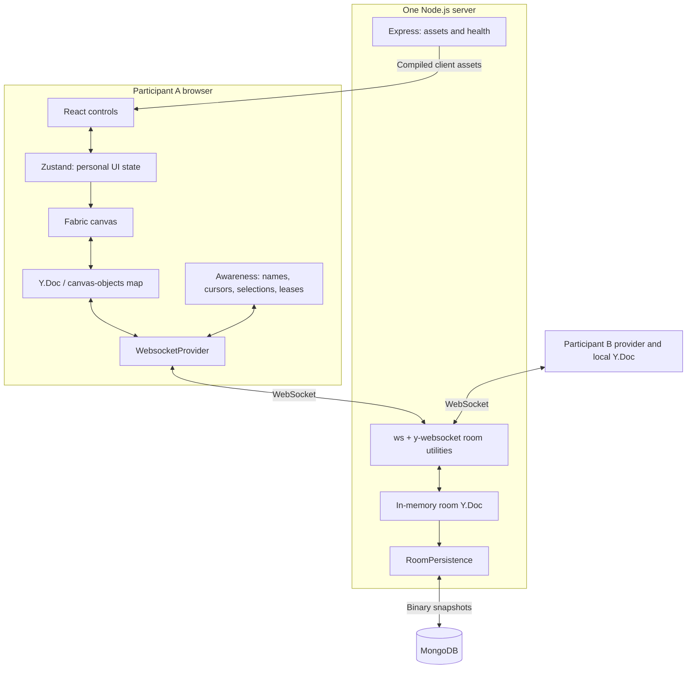

# Collaborative Whiteboard: technical guide and interview preparation

Prepared on **October 7, 2026**, from the current repository implementation.

This is a study guide for explaining the project on your résumé, tracing its code,
and discussing its engineering decisions. Implementation descriptions refer to
the repository source paths linked throughout this document. Examples marked
"simplified" illustrate the code; they are not additional implemented features.

The last implementation verification on October 6 recorded **34 passing tests**,
passing client/server production builds, and passing client lint. Writing this
guide does not constitute a new browser, database, container, or hosted CI test.

## Contents

1. [Project overview and interview introduction](#1-project-overview-and-interview-introduction)
2. [User experience and feature scope](#2-user-experience-and-feature-scope)
3. [Technology choices](#3-technology-choices)
4. [System architecture](#4-system-architecture)
5. [The five kinds of state](#5-the-five-kinds-of-state)
6. [Startup and room lifecycle](#6-startup-and-room-lifecycle)
7. [Object representation and serialization](#7-object-representation-and-serialization)
8. [Drawing and synchronization](#8-drawing-and-synchronization)
9. [Concurrent edits and remote reconciliation](#9-concurrent-edits-and-remote-reconciliation)
10. [Awareness and advisory editing leases](#10-awareness-and-advisory-editing-leases)
11. [Local undo and redo](#11-local-undo-and-redo)
12. [Group transforms and sticky notes](#12-group-transforms-and-sticky-notes)
13. [Personal themes and inspector logic](#13-personal-themes-and-inspector-logic)
14. [Navigation, cursors, and PNG export](#14-navigation-cursors-and-png-export)
15. [MongoDB persistence and failure handling](#15-mongodb-persistence-and-failure-handling)
16. [Interface design and accessibility](#16-interface-design-and-accessibility)
17. [Security boundaries](#17-security-boundaries)
18. [Performance and scaling](#18-performance-and-scaling)
19. [Repository map](#19-repository-map)
20. [Installation, configuration, and deployment](#20-installation-configuration-and-deployment)
21. [Testing and debugging](#21-testing-and-debugging)
22. [Demo script and résumé wording](#22-demo-script-and-résumé-wording)
23. [Interview questions and answers](#23-interview-questions-and-answers)
24. [Study plan, exercises, and glossary](#24-study-plan-exercises-and-glossary)

## 1. Project overview and interview introduction

### What the project does

Collaborative Whiteboard is a browser application where participants open a shared
room link and work on the same board. They can draw, create shapes, add text and
sticky notes, transform objects, see other participants' presence, and export the
board as a PNG. The server stores board documents in MongoDB so the same room can
be reopened later.

The core engineering problem is keeping an interactive, mutable canvas consistent
with a replicated document while handling concurrent edits, local history, and
asynchronous database writes. This is the part that makes the project more
substantial than a drawing interface alone.

### A 30-second introduction

> I built a collaborative whiteboard with React, TypeScript, Fabric.js, Yjs,
> WebSockets, and MongoDB. Fabric handles the interactive canvas, while Yjs
> replicates serialized objects between participants. I added collaborator
> presence, advisory editing leases, and local undo that checks for conflicting
> remote changes. On the server, room hydration finishes before synchronization,
> and a persistence coordinator batches and serializes MongoDB saves with retries.

Use "I built" for work you can personally explain and defend. Separate what you
implemented from what Fabric, Yjs, and the WebSocket provider supply.

### A two-minute explanation

Start with the user problem: people need a shared space for sketching ideas without
an account setup flow. Then explain the three main layers:

1. **Interaction:** React renders controls; Fabric owns canvas objects and gestures.
2. **Collaboration:** a Yjs map stores object snapshots; a WebSocket provider
   exchanges document updates; awareness carries temporary participant state.
3. **Durability:** one server-side document is maintained per active room, and its
   binary state is periodically written to MongoDB.

Then describe one difficult case: a remote deletion arrives during a local drag.
The code ends the affected interaction and applies the deletion rather than
letting the drag completion recreate the object. Finish with the current limits:
anonymous rooms, whole-object conflict granularity, one server instance, and
debounced persistence rather than an acknowledgment for every edit.

### Current maturity

This is a functional personal project with focused automated regression tests and
deployment configuration. It has not been established as a publicly deployed,
load-tested, authenticated production service. The remaining Fabric dependency
migration and browser/tablet/database end-to-end checks are documented work.

## 2. User experience and feature scope

### Typical user journey

1. Open the app. A room is read from `?room=...`, or a random room name is generated.
2. Share the current URL using the header's Share button.
3. Another participant opens that room and synchronizes its board document.
4. Draw or create objects, select them, and change their appearance.
5. See participants' cursors, selection outlines, and editing indicators.
6. Pan or zoom independently of everyone else.
7. Undo a local operation when its expected shared state still matches.
8. Export all board content as a PNG.
9. Return to the same room later to load its saved state.

### Implemented features

| Feature | Implementation | Important boundary |
|---|---|---|
| Freehand drawing | Fabric `PencilBrush` creates paths | Completed paths are shared; the application does not stream every brush point as a separate edit |
| Rectangles and circles | Drag creates a temporary local object | Tiny accidental shapes are discarded before shared commit |
| Editable text | Fabric `IText` | Text is stored as part of a whole object; this is not character-level collaborative text |
| Sticky notes | Fabric `Textbox` with custom metadata | Resizing reflows width and preserves font size |
| Object transforms | Fabric selection and transform events | Shared snapshots commit on completion; presence communicates editing activity |
| Group transforms | One Yjs transaction and one history entry | The temporary selection wrapper is not the persistent object |
| Appearance inspector | Zustand settings plus explicit property revision | Selecting an object must not itself edit it |
| Themes | Canonical ink plus local color conversion | A theme toggle does not change the shared document |
| Undo/redo | Local snapshot stacks with conflict checks | Conflicting operations can be skipped |
| Presence | Awareness fields | Names, cursors, and leases are transient |
| Room persistence | Binary Yjs state in MongoDB | Saves are asynchronous and debounced |
| Navigation | Local viewport transform | No explicit pinch-to-zoom implementation |
| PNG export | Separate Fabric static canvas | No SVG export or editable-document download |
| Clear board | Confirmation plus batched deletion | A room-wide destructive edit; leases do not provide ownership protection |

### Keyboard and pointer controls

| Action | Control |
|---|---|
| Select | `V` |
| Pan tool | `H` |
| Draw | `D` |
| Rectangle | `R` |
| Circle | `C` |
| Text | `T` |
| Sticky note | `N` |
| Temporary pan | Hold Space and drag |
| Pan | Wheel/trackpad scroll; middle-button drag |
| Horizontal pan | Shift + wheel |
| Pointer-centered zoom | Ctrl/Cmd + wheel |
| Undo | Ctrl/Cmd + Z |
| Redo | Ctrl/Cmd + Shift + Z, or Ctrl/Cmd + Y |
| Export | Ctrl/Cmd + Shift + E |
| Delete selection | Delete or Backspace |
| Deselect | Escape |

Text editing takes precedence over canvas shortcuts. The Space handler also avoids
interactive controls and dialogs. There is no separate keyboard-only drawing
system.

### Features that are not implemented

There are no authenticated accounts, board ownership, private invitations,
read-only roles, board dashboard, comments, image upload, SVG import/export,
version history, persistent local offline storage, server-enforced object locks,
or coordinated multi-server deployment. Names and `creatorId` are metadata, not
verified identity or authorization.

## 3. Technology choices

| Technology | Responsibility | Why it fits | Tradeoff |
|---|---|---|---|
| React | Application shell, controls, dialogs, overlays | Component composition and reactive UI | Must coordinate carefully with Fabric's imperative lifecycle |
| TypeScript | Compile-time contracts | Makes controller and event boundaries easier to inspect | Object snapshots still use `Record<string, any>`; runtime validation remains necessary |
| Fabric.js | Object canvas, hit testing, transforms, freehand paths, editable text | Avoids implementing a complete editor from raw canvas APIs | Mutable objects, event behavior, group coordinates, and serialization need adapters |
| Zustand | Local UI state | Small shared store for tools, settings, status, and history button state | Broad subscriptions can cause unnecessary renders |
| Yjs | Replicated document and conflict resolution | Shared types and binary synchronization | Correct merging depends on the selected data model |
| y-websocket | Document and awareness transport | Existing collaboration protocol and reconnection behavior | Server utilities and their lifecycle assumptions must be understood |
| WebSockets / `ws` | Bidirectional network channel | Participants can receive updates without polling | Reconnection, authorization, message limits, and proxy upgrades need handling |
| Express | Static client serving and health endpoint | Simple single-service production entry point | It does not itself supply room authorization |
| MongoDB | Persistent room documents | Stores one binary state per room | Repeated full-state writes grow with document size |
| Mongoose | Schema and storage adapter | Typed model, indexed room key, timestamps, upsert | A schema is not a complete security or concurrency policy |
| Vite | Client development and production bundling | Fast development server and conventional build | Client environment variables are resolved at build time |
| Tailwind / CSS | Utility classes and workspace layout | Useful for controls and responsive layouts | Main layout also uses substantial custom CSS |
| Node test runner / tsx | Regression execution | Existing toolchain supports TypeScript test loading | Headless behavior is not equivalent to real browser behavior |

### Lockfile versions in this snapshot

These are resolved versions from the current lockfiles, not claims about the
latest releases. The `package.json` ranges can differ from these exact versions.

| Package | Client | Server |
|---|---:|---:|
| React | 19.3.0 | — |
| Fabric | 5.5.2 | — |
| Zustand | 5.0.15 | — |
| Yjs | 13.6.33 | 13.6.33 |
| y-websocket | 3.1.0 | 2.1.0 |
| TypeScript | 6.0.3 | 5.9.3 |
| Vite | 6.4.4 | — |
| Tailwind | 4.3.3 | — |
| Node canvas | 3.2.3 | — |
| Express | — | 4.22.3 |
| ws | — | 8.22.0 |
| Mongoose | — | 8.24.5 |

The client and server deliberately do not have identical dependency lists. The
server imports `y-websocket/bin/utils` from its installed package; the client uses
`WebsocketProvider`. Existing integration tests demonstrate their tested protocol
interoperability. A future major migration must check these imports and behavior.

Node canvas supports Fabric's headless Node rendering and tests. It is not a
native canvas module downloaded into the browser; browsers provide their own
canvas implementation.

## 4. System architecture



The application follows a client-server topology. Yjs is the replicated data
layer; WebSockets are the transport. Fabric is a local projection of board data,
not the network protocol. MongoDB is persistent storage, not the channel used for
live communication.

The provider also supports communication between tabs on the same browser origin.
That means a two-tab demo alone can hide a broken server connection. Use separate
browsers or devices when demonstrating actual server-mediated collaboration.
See the official [y-websocket documentation](https://docs.yjs.dev/ecosystem/connection-provider/y-websocket).

### What Yjs contributes

Yjs supplies CRDT shared types. A CRDT is a replicated data structure designed to
converge under concurrent changes without requiring every replica to apply
messages in one global arrival order. You used that implementation; you did not
write a CRDT algorithm from scratch. See the [Yjs project](https://github.com/yjs/yjs).

The application still implements the binding between Fabric and the shared data,
decides the conflict granularity, and provides the UI behavior around conflicts.
Convergence does not automatically guarantee that every user's intended edit is
preserved.

## 5. The five kinds of state

| State | Owner | Example | Shared? | Survives browser reload? |
|---|---|---|---|---|
| Canvas view | Fabric | Selection, cached coordinates, current local drag | Local view only | Reconstructed from board data; current gestures are lost |
| Shared board document | Yjs | Object snapshots keyed by ID | Yes | Last saved server state can be reloaded |
| Participant presence | Awareness | Cursor, selected IDs, advisory leases | Yes, transiently | No |
| Personal UI and history | Zustand and refs | Theme, zoom, tool, undo stacks | No | No application persistence configured |
| Durable room snapshot | MongoDB | Binary encoded Y.Doc state | Server storage | Yes, after a successful write |

### Why separating them matters

A personal theme should not recolor another participant's document. A cursor
should not become permanent board content. Undo should not reverse another
participant's edit. A local viewport should not move everyone else's camera.
Finally, receiving a shared update should not be confused with saving it to disk.

The shared board document is the collaboration authority for committed object
snapshots. Fabric can temporarily differ during a local draft or gesture, and
MongoDB can lag until a save succeeds. There is therefore no single component
that represents every aspect of the application at every instant.

### React state versus refs

React state is used when a change must update the rendered interface. Refs retain
mutable integration state across renders without turning every canvas event into
a React render. Examples include:

- `fabricCanvasRef`: the imperative canvas instance.
- `objectIndexRef`: object ID to Fabric object lookup.
- `lastKnownObjectsRef`: last committed snapshots used for comparison/history.
- `activeInteractionIdsRef`: objects involved in a local interaction.
- `pendingRemoteRef`: remote edits/deletes queued during that interaction.
- `isUpdatingFromYjsRef`: prevents remote application from becoming a local edit.
- `historyPastRef` / `historyFutureRef`: local history stacks.
- `collaborationRef` / `stateRef`: current controller and settings for long-lived
  event handlers, avoiding stale closures.

The UI only receives `canUndo` and `canRedo`; the full mutable history is not
stored in Zustand.

## 6. Startup and room lifecycle

### Browser startup

1. [main.tsx](client/src/main.tsx) mounts `App` inside React StrictMode.
2. [useStore.ts](client/src/store/useStore.ts) reads the room query parameter.
   Without one, it generates a short random room and replaces the current URL.
3. The store creates a session user ID and a random display name. Default theme
   is dark, tool is Select, stroke width is 4, and font size is 24.
4. [App.tsx](client/src/App.tsx) mounts controls, notifications, and `useYjs`.
5. [useYjs.ts](client/src/hooks/useYjs.ts) creates a `Y.Doc` and provider inside an
   effect tied to the room lifecycle.
6. It publishes identity through awareness and installs connection/sync listeners.
7. `canvasObjectsMap` becomes available from `getMap('canvas-objects')`.
8. [Whiteboard.tsx](client/src/components/Whiteboard.tsx) creates Fabric, attaches
   handlers, observes the map, and renders existing snapshots.

The client canvas is not delayed until database durability is acknowledged. The
server's hydration barrier is a different mechanism: it prevents the server from
processing collaboration messages before loading the room's saved document.

### Server startup

1. [server.ts](server/src/server.ts) loads environment variables using dotenv.
2. It creates Express, an HTTP server, and a `WebSocketServer` in `noServer` mode.
3. The application's `RoomPersistence` takes ownership of document storage and
   cleanup; the library's persistence adapter is disabled with `setPersistence(null)`.
4. The process awaits MongoDB connection before starting HTTP listening.
5. HTTP requests serve the compiled client or `/health`; upgrade requests pass
   through room, origin, connection-count, and shutdown checks.

### Joining an existing room

```mermaid
sequenceDiagram
  participant B as Browser provider
  participant S as Node server
  participant R as RoomPersistence
  participant M as MongoDB
  B->>S: WebSocket upgrade /room-name
  S->>S: Validate path, origin, capacity
  S->>R: acquire(room-name), pause socket messages
  alt First active acquisition
    R->>M: Load saved binary state
    M-->>R: Saved state or no board
    R->>R: Apply update; attach persistence listener
  else Room already active or retained
    R->>R: Reuse document and readiness promise
  end
  R-->>S: Ready document and release handle
  S->>S: setupWSConnection; resume messages
  S-->>B: Yjs synchronization exchange
```

A database load failure does not silently create an empty replacement document.
The socket closes with retry-oriented code `1013`. A connection caught during
shutdown is closed with `1012`.

### Cleanup

Client cleanup removes listeners and timers, destroys the provider and awareness,
destroys the Y.Doc, disposes Fabric, disconnects resize observation, clears
history/indexes, and releases awareness leases. This matters when changing rooms,
unmounting, and during StrictMode's development lifecycle checks.

On the server, disconnect releases a room reference. After the last reference,
the coordinator flushes changed state and collects the document only when no
references remain and the saved version matches the current version.

## 7. Object representation and serialization

### The shared map

Conceptually:

```ts
const objects = doc.getMap<SerializedCanvasObject>('canvas-objects');
objects.set(objectId, serializedObject);
objects.delete(objectId);
```

Simplified rectangle snapshot:

```json
{
  "id": "object-uuid",
  "creatorId": "session-user-uuid",
  "type": "rect",
  "left": 100,
  "top": 80,
  "width": 200,
  "height": 100,
  "scaleX": 1,
  "scaleY": 1,
  "stroke": "#f3f4f6",
  "fill": "transparent",
  "strokeWidth": 4
}
```

Actual Fabric output includes more properties, such as origin, angle, visibility,
and version. Functions, DOM elements, and a live Fabric canvas are not stored.

### Why IDs are necessary

An ID links the Fabric object, Yjs map entry, history snapshots, object leases, and
presence selection. `createId()` prefers `crypto.randomUUID`, then constructs a
UUID from random bytes, and finally uses a timestamp/random fallback if neither
crypto API is available. This is object identification, not authentication.

### Custom properties

[fabricHelpers.ts](client/src/utils/fabricHelpers.ts) defines a shared list passed
to `toObject()`/`toJSON()`: `id`, `creatorId`, `backgroundColor`, `padding`, `shadow`,
`_isSticky`, `_stickyBaseFontSize`, `_stickyBaseWidth`, and `_stickyScale`.

Without these, an object can appear correct locally but lose metadata when another
participant reconstructs it or the room reloads.

### Enlivening

Serialization converts a Fabric instance into data. Enlivening reconstructs a
Fabric instance from that data. Remote new objects and history restoration use
`fabric.util.enlivenObjects` after runtime validation.

Reconstruction can be asynchronous. The callback therefore checks that the
component is still active and that the shared value still matches the snapshot
it started with. A late callback must not restore an object already deleted or
replaced by a newer update.

### Conflict granularity

Each map value is an ordinary object snapshot, not a nested `Y.Map`. A `left`
change and a `fill` change both replace the value at the same object ID. Different
object IDs are independent map entries; properties inside one snapshot do not
merge independently. The official [Y.Map API](https://docs.yjs.dev/api/shared-types/y.map)
describes its shared entries and supported values.

The app also has no separate shared ordered list for object layering. Avoid
claiming a comprehensive collaborative layer/z-order system.

## 8. Drawing and synchronization

### Creating a rectangle

1. Mouse-down records a world-space start pointer and creates a zero-sized draft.
2. Its ID goes into `pendingCreationIdsRef`, keeping `object:added` from sharing
   the unfinished shape.
3. Mouse-move updates the local dimensions and requests rendering.
4. Mouse-up discards a rectangle with either dimension below 5, or a circle with
   radius below 3.
5. A valid object becomes selectable and gets a canonical snapshot.
6. `commitNewObject` records a creation history entry, remembers the snapshot,
   and writes it into the shared map.

Circles use the maximum horizontal/vertical drag distance to determine radius.
They are circles, not independently stretched ellipse creation tools.

### Freehand and text

Fabric handles freehand sampling. Once a completed path is added, the ordinary
add handler assigns metadata and commits it.

Text and sticky notes begin as drafts with placeholder text and enter Fabric text
editing. On editing exit, an empty or unchanged placeholder draft is removed;
otherwise it is committed. Existing text edits commit on editing exit. The code
does not write a new Yjs value for every keystroke.

### Local update to another participant

```mermaid
sequenceDiagram
  participant FA as Alice Fabric
  participant YA as Alice Y.Map
  participant S as Room server
  participant YB as Bob Y.Map
  participant FB as Bob Fabric
  FA->>YA: Commit canonical object snapshot
  YA->>S: Provider sends binary document update
  S->>YB: Provider distributes update
  YB->>FB: Map observer applies changed object
  FB->>FB: Guard remote mutation; update coordinates; render
  S->>S: Persistence schedules a snapshot save
```

Yjs emits binary updates for document changes. Its updates can be reapplied and
received in different orders while still converging when replicas obtain the
necessary updates. `encodeStateAsUpdate` encodes state; `applyUpdate` applies it.
See [Yjs document updates](https://docs.yjs.dev/api/document-updates).

### Echo cancellation

Applying remote data to Fabric can fire the same events used for local edits.
Without a guard, the app could write that remote change back into Yjs, add fake
local history, and trigger redundant feedback.

The map observer ignores `event.transaction.local`, because local Fabric has
already performed those edits. In the opposite direction, `withRemoteUpdate`
sets `isUpdatingFromYjsRef` while applying remote Fabric mutations. Local listeners
return early while this guard is active. The helper restores the previous guard
in a `finally` block, including when an operation throws.

These are two different protections: transaction locality filters map events;
the ref filters Fabric events caused by remote application.

## 9. Concurrent edits and remote reconciliation

### Different objects

Alice changes rectangle A while Bob changes circle B. They update different map
entries, so both object updates can exist in the converged document.

### The same object

Alice moves rectangle A while Bob changes its fill. Each writes a complete
snapshot under A's ID. Yjs resolves competing writes deterministically, but this
does not combine Alice's position with Bob's fill automatically.

Do not describe this as "the last wall-clock edit always wins." Network arrival
time and users' real-time ordering are not the definition of CRDT conflict
resolution. The safe explanation is that replicas converge to the resolved map
value, and the application uses leases/reconciliation to reduce surprises.

### A remote edit during local drag

The app tracks active interaction IDs. A valid remote replacement for an active
object is put into `pendingRemoteRef` instead of rewinding the local drag on every
incoming event. At completion, `persistModifiedObject` checks for that pending
remote change and whether the shared entry still exists. If there is a conflict,
the local completion is discarded and the current shared snapshot is rendered.
A notification explains that the collaborator's edit was kept.

This chooses a concrete user-facing policy: retain the already-received remote
state rather than silently overwrite it with the local gesture's completion.
It is not a general semantic merge algorithm.

### A remote delete during local drag or text editing

Deletion queues a null marker, ends the affected interaction, exits text editing
under the remote-update guard if necessary, and removes the object. Completion
does not blindly write the old local object back into the map.

If a selected group contains the deleted member, the code detaches the selection
and ends interactions for its members so they do not retain stale editing leases.

### Asynchronous replacement

If an object is being enlivened when a newer shared value arrives, the callback
rechecks the map. It either applies the current value or abandons the obsolete
object. This prevents stale asynchronous work from resurrecting deleted content.

## 10. Awareness and advisory editing leases

### What awareness stores

Simplified local awareness state:

```ts
{
  user: { id: 'session-user-id', name: 'Alice' },
  presence: {
    cursor: { x: 200, y: 120, updatedAt: 1234567890 },
    selectedIds: ['object-id']
  },
  locks: [{
    objectId: 'object-id',
    ownerClientId: 123,
    ownerUserId: 'session-user-id',
    ownerName: 'Alice',
    claimedAt: 1234567000,
    expiresAt: 1234582000
  }]
}
```

Awareness is separate from the board's shared map. It communicates transient
participant state rather than durable content. The application does not persist
it in MongoDB. See the [awareness documentation](https://docs.yjs.dev/api/about-awareness).

### User ID versus Yjs client ID

`userId` is application session metadata. `awareness.clientID` identifies the
replica publishing awareness. Leases use the client ID to determine ownership and
verify that the lease's claimed owner matches the publishing awareness entry.
Neither value proves the participant's real identity.

The header's participant count comes from awareness-state entries, not a database
of unique people. One person in multiple sessions can appear as multiple
participants, and identity/display names are not authenticated.

### Lease lifecycle

1. Before a transform or text edit, collect all affected object IDs.
2. Refuse the interaction if another currently resolved lease owns any member.
3. Publish a lease array with a **15-second** expiry.
4. Renew during movement/scaling/rotation, and every **5 seconds** during an active
   interaction, including idle text editing.
5. Release affected leases when interactions finish or the component unmounts.
6. Rebuild resolved leases every **1 second**, expiring old entries.

When two lease claims compete, [leases.ts](client/src/utils/leases.ts) prefers the
earlier `claimedAt`; equal timestamps are resolved by the smaller client ID.
This gives participants a deterministic comparison once they have the same
awareness states. Since timestamps use device clocks, clock skew remains a limit.

### Why these are soft locks

The server does not reject Yjs writes because of a lease. A modified client can
ignore the UI rules. Awareness can be delayed, and simultaneous participants can
initially believe they acquired the same object. Thus leases improve cooperative
interaction; they are not distributed exclusive locks, authentication, or an
access-control boundary.

Selection alone is shown through presence; it does not permanently claim an
object. Actual transform/text interaction creates the editing lease.

## 11. Local undo and redo

### Data structure

Simplified types used in `Whiteboard.tsx`:

```ts
type ObjectChange = {
  objectId: string;
  before?: SerializedCanvasObject;
  after?: SerializedCanvasObject;
};
type HistoryEntry = { changes: ObjectChange[] };
```

| Operation | `before` | `after` |
|---|---|---|
| Create | Absent | New snapshot |
| Modify | Previous snapshot | Updated snapshot |
| Delete | Previous snapshot | Absent |
| Group transform / clear | Multiple changes | Multiple changes |

There are separate past and future stacks. Past history is capped at **100
entries**. A new local action clears redo. Remote changes are not added to the
local stack, and history is not saved in MongoDB.

### Conflict-aware replay

For undo, the shared map must still match `after`; the target is `before`.
For redo, it must match `before`; the target is `after`.

Before replay, every affected object must be unlocked by collaborators and match
its expected snapshot. `snapshotsMatch` compares recursively sorted object keys,
so JSON property ordering alone does not cause a mismatch.

If missing objects need reconstruction, the app enlivens them and then repeats
the conflict check. This second check closes the race between the initial check
and an asynchronous callback.

A successful replay modifies the map in one Yjs transaction under the remote
Fabric-event guard and moves the entry to the opposite stack. A conflicting
entry is removed from the source stack and skipped; it is not put into redo as
though undo had succeeded. Replays are refused during another replay or active
local interaction.

### Example

Alice creates a rectangle and later Bob changes its color. Alice's creation undo
expects the original rectangle snapshot. It no longer matches, so undo skips the
operation rather than deleting Bob's changed object.

### Limits

This is a custom snapshot history, not `Y.UndoManager`. A conflicting multi-object
entry is skipped as a unit. Checks compare state, not a complete revision history:
if another participant changes an object and later returns it to an identical
snapshot, equality cannot detect that intervening sequence. History also does
not restore private view state, old presence, or a durable historical database
version.

## 12. Group transforms and sticky notes

### Group coordinate problem

Fabric's temporary `ActiveSelection` gives selected objects a group coordinate
context. Persisting members while they are still in that context can send
group-relative positions that another canvas interprets as world positions.

On a completed group transform, the code remembers members and their previous
snapshots, discards the temporary active selection to restore world coordinates,
checks every member for conflict, and commits member snapshots inside one Yjs
transaction. Individual history recording is suppressed during that batch, then
one history entry containing all member changes is recorded.

A Yjs transaction groups local document mutations and observer notification. It
does not lock other clients globally and is not a MongoDB ACID transaction.

### Sticky-note resize problem

Ordinary canvas scaling changes text size along with the object. For a sticky
note, the desired interaction is a wider/narrower writing area with the same
font size and natural line wrapping.

The current override computes:

```text
scale = max(scaleX, scaleY)
newWidth = max(80, round(currentWidth × scale))
width = newWidth
scaleX = scaleY = 1
fontSize stays unchanged
```

Fabric 5 emits `object:modified` at completion rather than the custom
`object:scaled` event expected by the project's override. The completion handler
therefore explicitly fires `object:scaled` before serializing the final member
snapshots. Do not remove this without rechecking the event behavior.

The current implementation uses the larger scale axis and width-based reflow; it
is not independently resizable width/height with a fixed container height.

## 13. Personal themes and inspector logic

### Canonical ink

The storage convention is **dark-theme ink**. For example, the neutral pair
`#f3f4f6` / `#1e293b` uses light gray in a dark canvas and dark slate in a light
canvas. [canvasSnapshots.ts](client/src/utils/canvasSnapshots.ts) converts local
serialization to canonical colors and converts incoming data to the viewer's
theme.

The shared pairs live in [themeColors.ts](client/src/utils/themeColors.ts).
`IText` fill and path/rectangle/circle fill/stroke participate. Sticky textbox
colors remain fixed; custom accent colors outside the table remain unchanged.

Theme toggle updates local UI settings and guarded Fabric colors. It does not
write to the shared map or record board history. Two people can view the same
object with different neutral ink on their own backgrounds.

The mapping is color-based. It is not an explicit per-object "theme-aware" flag,
so an exact color belonging to a neutral swap pair receives that interpretation.
Adding new pairs requires checking both store settings and canvas snapshots.

### Inspector hydration versus edits

Selecting an object copies its current properties into the inspector using
`setSelectionProperties`. That should not modify the object.

Explicit setters such as `setStrokeColor` increment `propertyRevision`. The
property-edit effect listens to this revision, applies appropriate properties
to the active object, and fires `object:modified` to use the normal commit path.

This prevents an effect reacting to selection or theme-related control updates
from accidentally producing a shared edit. Text uses fill for text color and
font size; geometric objects use stroke, fill, and stroke width. The current
inspector does not implement batch property edits for an `ActiveSelection`.

## 14. Navigation, cursors, and PNG export

### World coordinates and viewport coordinates

Board objects exist in world coordinates. The viewport transform maps world
coordinates into visible canvas coordinates. In the application's normal
scale/translation view:

```text
screenX = worldX × zoom + panX
screenY = worldY × zoom + panY
worldX  = (screenX - panX) / zoom
worldY  = (screenY - panY) / zoom
```

Fabric stores the general affine transform as `[a, b, c, d, e, f]`. Pan changes
translation entries `e`/`f`; zoom changes scale while preserving a chosen anchor.

[viewport.ts](client/src/utils/viewport.ts) clamps zoom to **0.1–4** (10–400%).
Buttons multiply zoom by 1.25 or 0.8 around the canvas center. Ctrl/Cmd + wheel
zooms around the pointer. Fit computes all object bounds, uses an 80-pixel total
margin allowance, centers content, and avoids enlarging above 100%. Very large
boards can exceed the fit viewport because minimum zoom is still 10%.

Space temporarily disables drawing/selection for navigation, and blur restores
the selected tool behavior. None of these changes write board snapshots.

### Remote cursor rendering

Local pointers are converted into world coordinates before publishing. A remote
participant's world cursor is then converted through the receiving participant's
own viewport, so different zoom levels do not misplace it.

Cursor publication is throttled to roughly one send per **40 ms** while retaining
the latest pending position. Leaving the canvas clears it. The presence reader
rejects invalid or excessively large coordinates, hides cursors older than **15
seconds**, truncates display names to 40 characters, and accepts at most 100
selection IDs. Awareness refresh also updates expiry checks.

The overlay is a React/HTML layer with `pointer-events: none`, separate from board
objects. Selection bounds and editing labels update with render/viewport changes.
These overlays are not included in exported board content.

### Full-content PNG export

1. Serialize the current Fabric canvas, including custom object properties.
2. Load that data onto a separate `StaticCanvas`.
3. Compute full world-space content bounds, including negative/offscreen objects.
4. Add **32 pixels of padding** on each side.
5. Choose an export multiplier capped at 2, **8192 pixels per edge**, and
   **16 million total pixels**.
6. Produce PNG data and dispose the temporary canvas in `finally`.

The original viewport, selection, and history remain unchanged. The export uses
the current local rendering/theme. A local unfinished draft can be part of that
view; it is not an export of a separately acknowledged database checkpoint.

Desktop export uses an anchor download. iOS first attempts file sharing when
supported, then falls back to opening the PNG in a new tab. Share cancellation
is handled. Actual browser share/download and popup behavior require device
verification; headless PNG tests do not cover native OS dialogs.

## 15. MongoDB persistence and failure handling

### Database model

[Board.ts](server/src/models/Board.ts) defines:

| Field | Purpose |
|---|---|
| `boardId` | Required room key with unique/index declaration |
| `yDocState` | Required binary buffer containing encoded Yjs state |
| `createdAt`, `updatedAt` | Mongoose timestamps |

[db.ts](server/src/services/db.ts) loads using `findOne({ boardId })` and saves
with `findOneAndUpdate(..., { upsert: true })`. The room key is the lookup boundary;
board objects are not separate MongoDB documents.

The unique room constraint relies on MongoDB actually having the declared index;
Mongoose's `unique` schema option is an index declaration, not field validation.
There is no explicit index-readiness check in the application's startup flow.

This is a current-state store, not an append-only edit log or a version-history
database. Rooms have no automatic TTL or retention policy in this schema.

### Why binary Yjs state rather than canvas JSON

`Y.encodeStateAsUpdate(doc)` preserves the document representation that can be
applied to another Y.Doc. A Fabric JSON dump represents visible editor objects;
it is not the same representation as the replicated document and its CRDT
metadata. The persistence adapter stores encoded document state as a Buffer.

### The room coordinator

[RoomPersistence](server/src/services/roomPersistence.ts) keeps, per room:

- The in-memory Y.Doc and one shared hydration promise.
- A reference count for acquired connections.
- A current update counter `version` and successful-save counter `savedVersion`.
- A chained `writes` promise that serializes database writes.
- Debounce, maximum-wait, and retry timers.

These counters are process-local bookkeeping. They are not globally ordered Yjs
versions or a database optimistic-concurrency token.

### Hydration barrier

On first acquisition, the coordinator loads saved state and applies it before
connections start processing collaboration traffic. Concurrent acquisitions
reuse the same document and promise. The persistence update listener is installed
after loading, so reading an existing board is not itself treated as a new edit.

Without this barrier, a new empty server document could synchronize too early or
be saved before old content has loaded. A failed load causes refusal and cleanup,
not a write of an empty replacement board.

### Debounce and maximum wait

Each update resets a **2.5-second debounce**. The first update in a pending batch
also starts a **10-second maximum-wait** timer, preventing continuous activity
from postponing the scheduled save indefinitely.

Example: edits at 0 s, 1 s, and 2 s normally lead to a save around 4.5 s. Continued
edits can trigger the maximum-wait timer around 10 s. These are scheduling times,
not a guarantee that MongoDB finishes a write by that deadline.

### Serialized writes

Before encoding/writing, `flush()` chains work after the previous room write.
Encoding happens when the queued job executes, so it uses current document state.
After a successful write, `savedVersion` advances to the version captured for that
snapshot. Changes arriving during the write remain distinguishable as unsaved.

Why serialization matters: if an older snapshot's slow write finishes after a
newer's fast write, storage can regress. A per-room write chain prevents that
completion-order inversion inside this server instance.

### Retry and last-client disconnect

A failed write keeps the document in memory and schedules retry after **2.5
seconds**. A rejected write does not permanently poison later promise-chain work.

When the last client disconnects, the coordinator attempts a final flush. It
disposes the room only if there are still zero references and all current changes
are saved. If someone rejoins while that write is pending, they acquire the same
document, including newer edits, instead of loading a stale database copy.

### Shutdown

SIGINT/SIGTERM initiate controlled shutdown: stop accepting new connections,
terminate sockets, flush tracked rooms, disconnect MongoDB, and destroy remaining
documents. If flushing fails, the process logs the error and attempts shutdown
again after a retry delay. An external forced kill can still end the process
before a retry succeeds.

### Failure behavior table

| Situation | Current behavior | Remaining limit |
|---|---|---|
| Database unavailable at startup | Server awaits/attempts DB connection and does not start listening on failure | Service startup depends on DB availability |
| Room load fails | Refuse synchronization; close with retry-oriented code | No offline server fallback for that room |
| Save fails while running | Retain dirty document and retry | Retained state uses RAM and disappears on process loss |
| Last client leaves during failed save | Room remains until successfully saved | Dirty idle rooms can accumulate during a long outage |
| Rejoin during final save | Reuse the retained document | Coordination is process-local |
| Graceful stop | Attempt to flush before DB disconnect | External shutdown deadlines can interrupt retries |
| Abrupt crash | Recover last successfully saved state | Edits since that save can be lost |

### "Synced" versus "saved"

The header's Synced state comes from provider synchronization. It is not an
acknowledgment of MongoDB persistence. A visible object can exist on every
connected browser and the server while its database snapshot is still pending.
There is no per-edit database acknowledgment or Saved indicator in the current UI.

`/health` returns 200 when the Mongoose connection is ready, otherwise 503, plus
`pendingRooms`. It does not prove every dirty room is durable or provide a full
storage-latency/error monitoring system.

## 16. Interface design and accessibility

### Workspace structure

The desktop layout is a header, left tool rail, central canvas, and right
inspector. This gives room identity/status a stable location, separates creation
tools from appearance settings, and keeps most space available for drawing.

- `WorkspaceHeader` provides room information, connection state, history,
  sharing/export, participant count, name editing, and theme toggle.
- `ToolRail` selects tools and invokes clear.
- `InspectorPanel` changes appearance settings according to tool/selection type.
- `ViewportControls` provides zoom, fit, and reset.
- `Whiteboard` renders Fabric and the remote presence overlay.
- `ToastContainer` renders notifications and confirmations.

The header name input allows 15 characters. The presence reader separately caps
remote names at 40 characters; these are different boundaries.

### Responsive behavior

[index.css](client/src/index.css) defines desktop and smaller/coarse-pointer
layouts. On touch-oriented layouts, the tool rail becomes a horizontal bottom
bar and the inspector becomes an overlaid bottom sheet. The inspector starts
collapsed for coarse pointers or screens at most 900 pixels wide. Safe-area
insets support device edges, and the rail can scroll horizontally.

Some header details are hidden on very small screens to preserve main actions.
`touch-action: none` on the canvas avoids browser gestures interfering with
drawing, but this does not implement a complete multi-touch navigation system.
The bottom-sheet handle is a visual affordance; there is no drag-to-dismiss
controller attached to it.

### Accessibility work already present

Controls have accessible labels; tool and color buttons expose pressed state.
Notifications use a polite live region. Clear confirmation is a labelled modal
dialog: it focuses its first button, cycles Tab/Shift+Tab between its buttons,
cancels on Escape, and restores previous focus on close. Duplicate confirmation
requests reuse the existing pending promise instead of opening multiple dialogs.
The stylesheet honors reduced-motion preferences.

### Accessibility limits

The canvas objects do not have a comprehensive semantic DOM representation for
screen-reader navigation. Keyboard shortcuts are not a substitute for accessible
object creation and editing. The dialog focus handling is basic and has not been
established through a full assistive-technology audit. Presence overlays are
`aria-hidden`, so they are visual collaboration cues. Do not claim full WCAG
conformance or fully accessible drawing.

## 17. Security boundaries

### Room access

Anyone who can connect to a valid room name can edit its document. The short
random room identifier is convenient sharing, not a private-room security token.
There are no account checks, owner checks, or edit/read role checks. `creatorId`
does not constrain modification or deletion.

### Upgrade policy

[connectionPolicy.ts](server/src/services/connectionPolicy.ts) accepts paths of
the form `/room-name`, with letters, numbers, hyphens, or underscores, up to 128
characters. `/health` is reserved. Malformed/unsupported upgrade paths are refused.
The HTTP upgrade handler refuses new sockets during shutdown and when the
server has reached **128 concurrent sockets**. That is a configured cap, not a
measured number of users the application can support responsively.

WebSocket messages are capped at **2 MiB**. This also affects a large initial sync
message; it is not a complete per-board quota or aggregate rate limit.

### Browser origin policy

In production, browser connections must have a valid HTTP(S) Origin matching the
request host or an explicit `ALLOWED_ORIGINS` entry. Development additionally
permits a different port on the same hostname, which supports the Vite frontend.
The environment list contains exact origins without URL paths.

Clients without an Origin header are accepted. A native/modified client can
therefore connect without the browser-origin restriction. Origin checking reduces
unwanted browser-origin connections; it is not authentication. Express CORS
configuration and WebSocket upgrade checks are separate mechanisms.

For public deployment, use HTTPS/WSS behind a proxy preserving the Host header
and WebSocket upgrades. This is transport protection, not encryption of stored
boards or private room authorization.

### Runtime object validation

[validateObject.ts](client/src/utils/validateObject.ts) is a client rendering
boundary. Before remote enlivening, it restricts the document format to the tools
the app implements:

- Types: `rect`, `circle`, `path`, `i-text`, and `textbox`.
- Matching object/map ID and ID length at most 128.
- Allowed property categories; unknown fields are omitted.
- Finite numeric properties within an absolute bound of one million, with
  nonnegative checks on selected dimensions/properties.
- Text at most 10,000 characters and most other strings at most 256.
- Paths at most 50,000 segments with bounded segment contents.
- Bounded dash arrays and shadow fields.
- Rejection of dangerous prototype keys, external image types, object-valued
  patterns/gradients, non-null clip paths, and nonempty rich-text styles.

Invalid remote objects are hidden from the local canvas; that cleanup is guarded
and does not delete their entries from the shared map. Validation is not
comprehensive semantic validation of every Fabric property. Broad geometry bounds
can still permit expensive objects.

Most importantly, the server does not enforce this object schema on incoming Yjs
updates. A malicious client can transmit or persist unsupported data even if the
normal renderer declines to show it. The message cap alone does not prevent
repeated updates from consuming substantial memory or database space.

### Dependency status

The October 6 audits recorded zero server findings and one high-severity client
dependency finding for Fabric. The report included two SVG serialization XSS
advisories: [stored XSS via SVG export](https://github.com/advisories/GHSA-hfvx-25r5-qc3w)
and [gradient color-stop escaping](https://github.com/advisories/GHSA-w22m-hvvm-xmwx).

The current interface exports PNG and the supported document format excludes
gradients. That limits the implemented exposure paths, but does not establish
that every possible path is safe or remove the vulnerable dependency. Migration
to a patched Fabric major and regression verification remain necessary. Do not
run a forced major upgrade and assume the existing Fabric integration still works.

### If asked how you would secure public rooms

Describe proposed work explicitly as proposed: authenticate users, authorize
membership/roles before a WebSocket joins a room, enforce document/resource
constraints at the server boundary, add rate limits and retention policy, and
test unauthorized access with real sockets. Client-side UI disabling is not a
replacement for server-side enforcement.

## 18. Performance and scaling

### Existing measures

| Measure | Benefit | Limit |
|---|---|---|
| ID-indexed Fabric objects | Avoid repeatedly scanning for a changed object's ID | Rendering and some reconciliation still traverse the board |
| Commit on interaction completion | Reduces document writes during drags and text editing | Others do not receive every intermediate transform/keystroke |
| Transient throttled cursors | Reduces frequent presence traffic | Awareness still produces UI updates |
| Batched group changes | One transaction/history operation for a group | Does not reduce the snapshot size of each member |
| Debounced persistence | Coalesces rapid updates into fewer writes | Adds a durability delay |
| Per-room write queue | Prevents overlapping write completion races | Slow storage creates queueing |
| Request-based rendering | Lets Fabric schedule renders | Large canvases and presence updates can remain costly |
| Capped export resolution | Bounds output image dimensions | Object reconstruction and bounds calculation still have costs |
| Immutable hashed assets | Production asset caching for one year | Browser still downloads the initial bundle when uncached |

The last local build produced an approximately **691 kB minified / 209 kB gzip**
JavaScript entry bundle and emitted Vite's large-chunk warning. This is a dated
build observation, not a loading-time benchmark. Fabric and the application
editor code are included in that bundle.

### What grows with board size

A same-object edit sends a replacement serialized snapshot through Yjs; it is
not an application-level property delta. Large paths/text can therefore make an
edit expensive. MongoDB persistence encodes and writes full current Yjs state.
Theme changes, fit/export bounds, and lock-interactivity reconciliation can scan
all objects. History stores before/after snapshots, so a cap of 100 entries is
not a fixed memory-byte cap. Presence overlays also update React state.

### Why multiple servers are not currently safe

Each server process has its own room registry, reference counts, write queue,
and version counters. Two independent instances editing the same room could
hold divergent documents and overwrite the same database record with different
snapshots. Sharing MongoDB does not automatically coordinate those processes.

One proposed path is one designated owner per room with room-aware routing and
failover. Another is a coordinated distributed update/persistence design. Both
need cross-process synchronization and storage ordering; simply adding a load
balancer or Pub/Sub does not solve snapshot races by itself.

### Measurements to make before claiming scale

Measure connection count, active/dirty rooms, object counts and snapshot bytes,
message bytes per second, update-to-render latency, event-loop delay, save latency,
retry frequency, memory use, and reconnect recovery. Use different object/path
sizes and realistic editing workloads. There is no existing load-test evidence
for a particular number of simultaneous editors or latency target.

## 19. Repository map

### Start here

| File | Responsibility | What to look for |
|---|---|---|
| [App.tsx](client/src/App.tsx) | Wires UI, collaboration, and canvas controller | Component ownership and inspector visibility |
| [useStore.ts](client/src/store/useStore.ts) | Personal UI state and setters | Room initialization and `propertyRevision` |
| [useYjs.ts](client/src/hooks/useYjs.ts) | Provider/document lifecycle and awareness | Sync status, leases, cursor throttle, cleanup |
| [Whiteboard.tsx](client/src/components/Whiteboard.tsx) | Fabric-to-Yjs binding and interaction orchestration | Guard, drafts, history, reconciliation, event handlers |
| [server.ts](server/src/server.ts) | Server startup, upgrades, and shutdown | Capacity checks, coordinator ownership, flush |
| [roomConnection.ts](server/src/services/roomConnection.ts) | Hydration-gated socket setup | Pause/acquire/setup/resume/release |
| [roomPersistence.ts](server/src/services/roomPersistence.ts) | Room readiness, writes, retry, collection | Version counters, timer policy, serialization |
| [db.ts](server/src/services/db.ts) | MongoDB adapter | Load/save operations |
| [Board.ts](server/src/models/Board.ts) | Persistence schema | Room index and binary state |

### Supporting modules

| File | Purpose |
|---|---|
| [canvasSnapshots.ts](client/src/utils/canvasSnapshots.ts) | Clone, stable equality, canonical/local-theme snapshots |
| [fabricHelpers.ts](client/src/utils/fabricHelpers.ts) | Shared custom serialization property list |
| [themeColors.ts](client/src/utils/themeColors.ts) | Neutral ink conversion pairs |
| [leases.ts](client/src/utils/leases.ts) | Validate and resolve candidate awareness leases |
| [presence.ts](client/src/utils/presence.ts) | Validate participant cursors/selections and assign colors |
| [validateObject.ts](client/src/utils/validateObject.ts) | Supported object format at the renderer boundary |
| [viewport.ts](client/src/utils/viewport.ts) | Navigation, bounds, and separate-canvas PNG generation |
| [notifications.ts](client/src/utils/notifications.ts) | Toast subscriptions and shared confirmation promise |
| [id.ts](client/src/utils/id.ts) | Object/session identifier generation |
| [types/whiteboard.ts](client/src/types/whiteboard.ts) | Snapshot/controller contracts |
| [types/collaboration.ts](client/src/types/collaboration.ts) | Presence/lease/controller contracts |
| [app.ts](server/src/app.ts) | Injectable Express app for assets and health |
| [connectionPolicy.ts](server/src/services/connectionPolicy.ts) | Origin parsing and room upgrade policy |
| [index.css](client/src/index.css) | Workspace styling, breakpoints, overlays, touch layout |
| [scripts/test-client.mjs](scripts/test-client.mjs) | Runs TypeScript client tests through the server's tsx loader |

### Active and older UI components

The mounted UI uses `WorkspaceHeader`, `ToolRail`, `InspectorPanel`,
`ViewportControls`, `Whiteboard`, and `ToastContainer`. Files such as `Toolbar`,
`PropertiesPanel`, `ConnectionStatus`, and `UserIdentity` remain in the repository
but are not mounted by the current `App`. Read the active component tree rather
than treating every component file as an active feature.

### Architectural cleanup still worth doing

`Whiteboard.tsx` combines canvas lifecycle, object binding, gestures, history,
theme application, export delivery, and selection behavior. Some supporting
logic has been extracted, but the orchestration remains large.

A future refactor could extract explicit collaboration binding and history
controllers, keeping existing integration tests as behavior checks. Avoid
splitting functions merely to reduce line count; make lifecycle ownership,
mutations, and conflict decisions easier to follow.

## 20. Installation, configuration, and deployment

### Development

Use a supported Node runtime; the repository documents Node **22.12+**, and CI
and Docker use Node 22. The previous local Node 20.13 runtime emitted engine
warnings for parts of the toolchain even though local checks passed.

From the repository root:

```powershell
npm ci
npm ci --prefix client
npm ci --prefix server
npm run dev
```

MongoDB must already be reachable. Default URL:
`mongodb://127.0.0.1:27017/collaborative-whiteboard`.

Development normally uses client port 5173 and server port 5001. Vite may choose
another available client port. Open the URL Vite prints, with a room query such
as `?room=interview-demo`.

### Environment variables

| Variable | Where | Meaning |
|---|---|---|
| `PORT` | Server runtime | HTTP and WebSocket listening port; default 5001 |
| `MONGO_URI` | Server runtime | MongoDB connection URL |
| `NODE_ENV` | Server runtime | Set `production` to use the stricter browser-origin policy |
| `ALLOWED_ORIGINS` | Server runtime | Comma-separated explicit HTTP(S) browser origins |
| `VITE_WS_URL` | Client build/dev environment | Optional explicit WebSocket base endpoint |

Templates are [server/.env.example](server/.env.example) and
[client/.env.example](client/.env.example). Server settings can live in
`server/.env`; client Vite overrides can live in `client/.env.local`. Use your
existing settings rather than overwriting them blindly. Environment files are
ignored by Git. Anything bundled through a client `VITE_` variable is visible to
the browser; do not put database credentials there.

Without an override, development connects to the current page hostname on port
5001; production uses the page's own host/port. HTTPS selects WSS. Changing
`VITE_WS_URL` for a production frontend requires rebuilding that frontend.

### Production build on the same host

```powershell
npm run build
$env:NODE_ENV = 'production'
npm start
```

`npm run build` builds the client with TypeScript/Vite and the server with
TypeScript. `npm start` runs the compiled server, which serves `client/dist` and
WebSockets at `http://localhost:5001`. The server needs MongoDB. Development
`tsx watch` and production `node dist/server.js` are different execution paths.

`npm run preview --prefix client` is a separate client preview server. Because the
production frontend defaults to its own host, that preview needs an appropriate
build-time WebSocket override to reach a separately running backend.

### Docker and public hosting

[Dockerfile](Dockerfile) uses a Node 22 build stage and a smaller runtime stage,
copies compiled outputs, runs the server as the `node` user, and checks `/health`.
Browser build installation skips native lifecycle scripts; headless tests are
run separately in CI with native-library support.

[compose.yaml](compose.yaml) runs the application and MongoDB, waits for database
health, retains boards in a named volume, binds app port 5001 to host loopback,
and allows 45 seconds for graceful stop. The MongoDB service is not published as
a host port. These files are configuration; container execution has not yet been
verified in this session.

For a public site, the intended topology is one app instance behind an HTTPS
proxy with WebSocket upgrade support. A separately hosted frontend needs both
`VITE_WS_URL` at build time and an allowed browser origin at the backend. See
[DEPLOYMENT.md](DEPLOYMENT.md) for commands and an Nginx example.

Do not claim "deployed with Docker" merely because a Dockerfile exists. Likewise,
the GitHub Actions workflow exists locally, but its hosted execution was not
verified during the implementation pass.

## 21. Testing and debugging

### Verification commands

```powershell
npm run build
npm test
npm run lint --prefix client
```

The last recorded run passed **24 client tests + 10 server tests = 34**. These
are test cases, not a coverage percentage or proof of every input combination.

### Test layers

| Test file | Main coverage |
|---|---|
| [collaboration.test.ts](client/test/collaboration.test.ts) | Theme snapshots, stable comparison, lease resolution/expiry |
| [validation.test.ts](client/test/validation.test.ts) | Local tool snapshots accepted; malformed/external data rejected |
| [viewport.test.ts](client/test/viewport.test.ts) | Zoom bounds, pan, Space/blur, content fit, PNG bounds, stale presence |
| [whiteboard.test.ts](client/test/whiteboard.test.ts) | Real React/Fabric binding: group history, sticky resize, remote conflicts, inspector, dialog, overlays |
| [app.test.cjs](server/test/app.test.cjs) | Static client serving, readiness response, origin/path policy |
| [roomConnection.test.cjs](server/test/roomConnection.test.cjs) | Two actual WebSocket clients, delayed hydration, edit/delete sync, failed load |
| [roomPersistence.test.cjs](server/test/roomPersistence.test.cjs) | Concurrent acquisition, ordered writes, rejoin, retry, max wait, reload |

Client integration tests use Fabric's installed Node DOM/canvas environment and
mount React with `act`. Server tests inject a storage adapter; they do not need
MongoDB. The socket tests disable provider cross-tab communication so they test
real network exchange. Timed persistence tests use short configured delays rather
than waiting full production intervals.

### What is still outside the test evidence

Real Safari/iPad gestures, native sharing, visual layout, popup behavior, actual
MongoDB outage/restart, forced process loss, large-board resource exhaustion,
multi-server routing, Docker execution, hosted CI, and accessibility tool testing
need separate verification. Do not describe injected storage tests as MongoDB
integration tests.

### CI policy

[checks.yml](.github/workflows/checks.yml) runs on pushes and pull requests with
Node 22, installs native canvas build prerequisites, installs all dependencies,
builds, tests, and lints. It also runs server audit with a high-severity failure
threshold and client audit with a critical-severity threshold. The client gate
therefore does **not** block the known high-severity Fabric finding. That is a
current compromise, not a clean-client-audit claim.

### Debugging table

| Symptom | Check first | Reason |
|---|---|---|
| Page cannot connect | Printed Vite URL, server logs, browser Network WebSocket entry | Wrong host/port or backend not listening |
| Works on PC, not iPad | LAN hostname/IP, firewall/private network, guest Wi-Fi isolation | iPad `localhost` is the iPad, not the PC |
| Two tabs sync despite backend trouble | Repeat in separate browser/device and inspect socket status | Cross-tab exchange can bypass the server path |
| Header says Synced but restart loses edits | Save/retry logs, DB readiness, wait for a successful snapshot | Synced is not a persistence acknowledgment |
| Object jumps after group edit | Member world coordinates and active selection teardown | Fabric group-relative coordinates may have been serialized |
| Endless remote updates/history entries | Guard state and transaction locality | Echo cancellation may be bypassed |
| Sticky font becomes larger | Completion event and scale normalization | Width-reflow override may not have run |
| Undo does nothing | Expected snapshot equality and collaborator leases | A conflicting entry is intentionally skipped |
| Remote object never appears | Object validator and latest-value async check | Unsupported data is hidden or stale enlivening is discarded |
| Production frontend cannot sync | Build-time `VITE_WS_URL`, proxy upgrades, Host header, origins | Production topology differs from development |
| Native canvas install fails | Node version, prebuilt binary availability, native libraries | Headless Fabric depends on platform canvas support |

### Useful debugging invariant

For a committed object, compare its canonical Fabric snapshot with the map value,
the last-known snapshot, and its interaction/pending-remote state. If they differ,
identify whether a draft, active gesture, queued remote change, or stale callback
explains it before adding another synchronization write.

## 22. Demo script and résumé wording

### A five-minute demo

Use a new room rather than a board containing content you care about.

1. Open the same room in two different browsers/devices and confirm WebSocket
   synchronization, not just same-origin tab communication.
2. Create a rectangle and completed text in one browser; show them in the other.
3. Move an object and show editing presence and the completed remote transform.
4. Create a sticky note with enough words to wrap. Resize it and show unchanged
   font size with changed line wrapping.
5. Select two shapes, transform them, and undo once to reverse the group action.
6. Use different themes; show readable neutral ink and stable sticky/custom colors.
7. Pan and zoom one participant's view while the other view stays put.
8. Move content outside the visible area; export and show that it is included.
9. Explain the snapshot conflict check in undo rather than forcing a timing-sensitive
   race live unless you have rehearsed it.
10. Wait for a successful database save, stop gracefully, restart, and reopen the
    room to demonstrate persistence. Perform this only with real MongoDB running.

If a capability has not been verified on the demonstration setup, explain its
test evidence and limitation accurately rather than improvising an unsupported
claim.

### Résumé bullet examples

- Built a real-time collaborative whiteboard using React, TypeScript, Fabric.js,
  Yjs, and WebSockets, supporting shared objects, collaborator presence, and
  independent viewport navigation.
- Implemented conflict-aware local undo/redo, batched multi-object transforms,
  and remote edit/delete reconciliation to prevent stale canvas actions from
  overwriting newer shared state.
- Designed MongoDB-backed Yjs snapshot persistence with hydration gating,
  debounced serialized writes, retries, and safe document reuse during rejoin;
  added 34 client/server regression tests.

Only use counts and claims while they still match the repository. Avoid invented
latency improvements, user counts, uptime, or scale results. "MongoDB-backed
persistence" is supported; "zero data loss" is not. "Advisory object leases" is
supported; "secure distributed locking" is not.

### Engineering stories to prepare

**Theme bug:** a local view preference could become a shared mutation. The remedy
is canonical storage colors, local resolution, and guarded theme application.
Explain why comparing/undoing raw theme-dependent snapshots would be misleading.

**Group transform bug:** members inside a temporary selection can have relative
coordinates. The remedy is restoration to world coordinates before a batched
commit and one history entry. Explain how the test asserts the stored positions.

**Persistence race:** loading, saving, disconnecting, and rejoining overlap. The
remedy is a shared readiness promise, serialized writes, reference tracking, and
retaining dirty documents until save succeeds. Explain the injected failing/slow
storage tests.

These are descriptions of problems addressed by the implementation. Do not
invent a production incident, real-user impact, or measurement that did not occur.

## 23. Interview questions and answers

Use these as practice answers, not a script to memorize word for word. Be ready
to open the referenced file and trace the behavior.

### 1. What makes this more than a drawing application?

The canvas is bound to a replicated document shared across participants. The
interesting work is conflict behavior, remote/local event separation, local
history, awareness, and durable snapshot coordination, rather than drawing alone.

### 2. Why Fabric instead of raw canvas?

Fabric supplies object selection, hit testing, transforms, freehand paths,
editable text, and serialization. Raw canvas would require building those editor
behaviors. The cost is adapting an imperative object model and understanding its
events, coordinate systems, and serialization conventions.

### 3. Why React if Fabric draws the canvas?

React owns the surrounding application interface and state-driven controls.
Fabric owns frequent interactive canvas work. The code connects them through
effects, refs, store settings, and a canvas controller rather than rendering each
canvas object as a React component.

### 4. Why Zustand? Why not put the entire board there?

Zustand is used for personal UI state shared by controls. Board replication belongs
to Yjs, while live Fabric objects and history bookkeeping live in refs. Putting
all three into one store would blur ownership and could make high-frequency
canvas work unnecessarily trigger UI renders. Context or another store could
also serve the UI; Zustand is an implementation choice, not a unique requirement.

### 5. What is a CRDT, and did you implement one?

A CRDT is a data structure that supports convergent replicated changes under its
defined rules. Yjs supplies that implementation. I implemented the application's
canvas binding, data model, and conflict-handling UX around it.

### 6. Why not just broadcast canvas JSON over WebSockets?

A transport can send JSON, but a naive full-board replacement needs its own
handling of concurrent edits, missing updates, and reconnection. Here Yjs manages
replicated shared entries and protocol synchronization. The app still serializes
whole individual objects, so it has not eliminated all replacement-granularity
tradeoffs.

### 7. What is the difference between Yjs and WebSockets?

Yjs defines the replicated document and update semantics. WebSockets carry
messages between browser and server. The provider connects them; neither the
socket alone nor MongoDB supplies CRDT conflict resolution.

### 8. Do two users editing different properties of one object merge?

Not independently in the current model. The whole snapshot is one map value.
Concurrent position/color edits can compete at that entry. Property-level
collaboration would require a different shared schema and careful decisions
about grouping transforms and other invariants.

### 9. Is text collaborative at character level?

No. Text content is part of an `IText`/`Textbox` snapshot and commits on editing
exit. A `Y.Text` binding would be a different feature. Existing leases discourage
simultaneous cooperative editing of the same object.

### 10. How do you prevent synchronization loops?

The map observer ignores local transactions, and remote Fabric mutations run
with `isUpdatingFromYjsRef` set. Local canvas listeners return while that guard
is active. This prevents remote application from being recorded as new local
history or written back through the local event path.

### 11. What happens if a collaborator deletes an object I am dragging?

The remote delete ends the affected interaction and removes it under the guard.
The completion path checks current shared state/pending remote changes so it
does not recreate the stale local object. There is a regression test for this.

### 12. Are your locks distributed exclusive locks?

No. They are expiring awareness leases enforced by cooperating clients. The
server does not authorize writes based on them. Network delay, clock skew, and
modified clients limit exclusivity.

### 13. Why do leases expire and renew?

Participants can disappear without sending a clean release. Expiry prevents
their advisory lock lasting forever. Renewal keeps an active gesture or idle
text editing session from losing its lease just because no movement event fired.

### 14. Why custom undo rather than global snapshot restore?

Restoring a whole old board could overwrite unrelated remote work. Here history
contains only the local action's affected objects, and replay checks their
expected current snapshots. Conflicts cause a skip rather than a blind restore.
The implementation is custom snapshot history, not Yjs UndoManager.

### 15. Why recheck undo after enlivening?

Object creation can be asynchronous. A collaborator may change shared state
after the first check but before reconstruction finishes. The second check keeps
that callback from committing against obsolete assumptions.

### 16. Why does a group operation need special handling?

Members can temporarily use group-relative coordinates. The completion handler
discards `ActiveSelection` before serialization, commits all members in one
transaction, and records one history entry. A conflict in a member cancels the
group completion instead of leaving a partial locally intended action.

### 17. How do sticky notes resize without scaling text?

At completion, the scale is folded into textbox width and scales reset to one;
font size is retained. Fabric then reflows the text. The custom scaling event is
explicitly invoked from the modified handler for the current Fabric version.

### 18. Why don't themes synchronize?

They are a personal view preference. The document stores canonical neutral ink,
and each viewer maps it to their background. A theme change is local and guarded,
so it cannot create a shared edit or invalidate history through color changes.

### 19. What is stored in MongoDB?

One document per room key, containing binary encoded Yjs state and timestamps.
Individual objects are entries inside that encoded document, not separate Mongo
records. Presence and local undo history are not stored.

### 20. Why wait for hydration before socket synchronization?

If the server synchronizes before the saved room loads, it can start with an
incorrectly empty document or race persistence. Connections await the same room
readiness promise; a load failure refuses access rather than overwriting storage.

### 21. Why debounce saves, and why also have maximum wait?

Debounce batches bursts and reduces repeated database writes. Continuous editing
could keep resetting a debounce indefinitely, so a separate maximum-wait timer
schedules a flush. Neither timer guarantees successful storage during an outage.

### 22. Why serialize database writes?

An older slow snapshot must not finish after a newer write and regress the stored
room. A promise chain orders writes per room. Encoding when queued work executes
also avoids committing a snapshot captured unnecessarily early.

### 23. What if the last participant disconnects and someone immediately rejoins?

The coordinator retains the document while the final save is pending. The new
participant acquires that same document and increments references. Cleanup only
happens after durability and zero references, so rejoin does not load a stale
snapshot during that window.

### 24. Can a Synced board still lose data?

Yes. Synced describes provider document exchange, not database acknowledgment.
Abrupt loss of the server before a pending save succeeds can lose changes since
the last durable snapshot. A browser that still holds updates may later help
restore them, but the app cannot guarantee that a client survives the failure.

### 25. Does the app work offline?

An already-open session has an in-memory document and can make local changes
while disconnected; the provider can resynchronize on reconnect. There is no
IndexedDB document persistence or service worker. Reloading while offline can
lose unsent state or prevent loading the app. Call this reconnection support,
not a fully offline-ready application.

### 26. Is sharing a room link secure?

It is convenient anonymous access. Possession/discovery of the room name permits
editing, and no verified identity or role is checked. Origin checks control
browser connection origins, not who is authorized to edit the room.

### 27. Can validation on the client protect the server?

It protects the normal rendering path from unsupported snapshots. The server
still accepts Yjs messages from arbitrary clients within its transport checks.
Server-side resource and authorization controls are needed for stronger
protection; client-side rendering validation cannot enforce them.

### 28. How would you scale the system?

First measure the actual bottleneck. Today there is one authoritative process
per room lifecycle. Multiple instances require coordinated room routing/update
exchange and safe persistence ordering. A load balancer plus the same MongoDB
is not sufficient because full snapshots can overwrite one another.

### 29. How do you know it is correct?

There are 34 focused regression cases, including real headless Fabric/React
integration and two real WebSocket clients. Persistence tests inject delayed and
failing storage to exercise races. The evidence does not replace real browser,
MongoDB, container, accessibility, or load verification.

### 30. What would you improve next?

Resolve the Fabric advisory through a tested migration, verify real browser and
database failure flows, define public-room access/resource policy, extract dense
canvas orchestration, and publish a reproducible demo. Property-level shared
state and persistent offline support are product changes to evaluate separately.

## 24. Study plan, exercises, and glossary

### Recommended reading order

1. Read sections 1–5 and redraw the architecture without looking.
2. Open `App.tsx`, `useStore.ts`, and `useYjs.ts`; follow one room from URL to map.
3. Trace rectangle creation in `Whiteboard.tsx`, from draft to shared snapshot.
4. Trace a remote map event through the guard into Fabric.
5. Read leases, interaction reconciliation, and history replay together.
6. Read `roomConnection.ts`, `roomPersistence.ts`, `db.ts`, and `Board.ts` in that
   order; follow hydration, save, failure, disconnect, and rejoin.
7. Read the regression tests and explain what each assertion protects.
8. Run the demo and answer section 23 aloud using your own wording.

### Practice exercises

These are learning exercises, not claims about completed verification.

- Explain why moving the camera does not modify `left`/`top` in the shared map.
- Write down the before/after snapshots for create, edit, delete, and clear.
- Explain why a received remote update should never create local history.
- Predict what happens if a remote delete arrives before enlivening finishes.
- Draw the sequence when a save fails, the room becomes empty, and a participant
  rejoins before retry succeeds.
- Demonstrate why changing two properties of the same ordinary object snapshot
  is different from changing two separate shared map entries.
- Find each timer and explain its purpose: cursor throttle, lease expiry scan,
  lease renewal, save debounce, maximum wait, and retry.
- Explain what the health endpoint can and cannot prove.
- Identify which résumé statements need measurements you do not currently have.

### Concepts to know precisely

| Term | Meaning in this project |
|---|---|
| CRDT | Yjs's replicated shared-data mechanism, not an application-written algorithm |
| Replica | A participant/server Y.Doc holding its view of the shared document |
| Provider | Adapter exchanging document/awareness state over a transport |
| Shared map | ID-indexed collaborative object entries |
| Snapshot | Serialized state of an object, or an encoded full document depending on context |
| Serialization | Converting live editor objects into transport/storage data |
| Enlivening | Reconstructing Fabric instances from serialized data |
| Awareness | Temporary participant information, separate from board content |
| Lease | Expiring advisory ownership claim during interaction |
| Transaction | Group of Yjs mutations; not a global lock or database transaction |
| Hydration | Loading and applying the saved room document before processing client sync |
| Debounce | Delay restarted by new edits to batch nearby writes |
| Maximum wait | Independent deadline to schedule a write during continuous editing |
| Idempotent update | Applying the same Yjs update again does not duplicate that change |
| Echo cancellation | Preventing remote Fabric mutations from being handled as local edits |
| World coordinates | Object positions independent of a viewer's camera |
| Viewport transform | Mapping from board coordinates to the visible canvas |
| Durability | Successful persistence beyond the lifetime of this server's memory |
| Eventual convergence | Replicas agree after obtaining the necessary updates; not every intent necessarily survives |
| Optimistic local interaction | The canvas responds locally before waiting for network/database completion |

### Final self-check

You understand the project when you can explain, without memorizing this guide:

- Where each kind of state lives and why it lives there.
- How an object moves from local creation to another canvas and into MongoDB.
- What happens when users conflict, a callback finishes late, or storage fails.
- Which behavior is provided by a library and which behavior your application adds.
- What is currently implemented, what is tested, and what remains an assumption.

Use [README.md](README.md) for everyday commands,
[DEPLOYMENT.md](DEPLOYMENT.md) for hosting setup, and
[PROJECT_REVIEW.md](PROJECT_REVIEW.md) for historical findings and remaining work.
